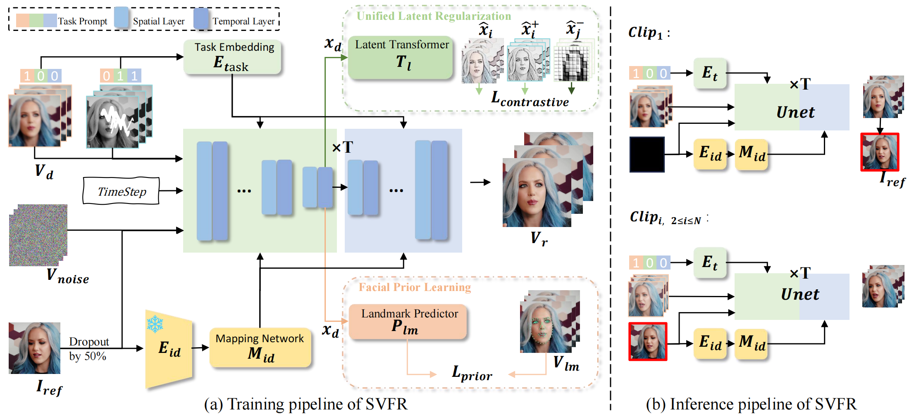

# SVFR



SVFR — единый фреймворк для восстановления лиц в видео, который объединяет улучшение качества, колоризацию, инпейнтинг и их комбинации. Проект рассчитан на обработку видеороликов с лицами и предоставляет как CLI-инференс, так и локальную Gradio-демонстрацию.

## ✨ Особенности
- Объединяет BFR, colorization, inpainting и смешанные сценарии в одном пайплайне.
- Работает с видео и умеет предварительно выделять область лица.
- Использует конфигурацию через YAML и набор моделей из папки `models`.
- Поставляется с демо, примерами входных данных и Gradio-интерфейсом.
- Ориентирован на GPU-окружение с достаточным объёмом видеопамяти.

## 🚀 Быстрый старт
### Создание окружения
```bash
conda create -n svfr python=3.9 -y
conda activate svfr
```

### Установка PyTorch и зависимостей
```bash
pip install torch==2.2.2 torchvision==0.17.2 torchaudio==2.2.2
pip install -r requirements.txt
```

### Загрузка моделей
```bash
conda install git-lfs
git lfs install
git clone https://huggingface.co/stabilityai/stable-video-diffusion-img2vid-xt models/stable-video-diffusion-img2vid-xt
```

## 📁 Структура проекта
- `src` — основная реализация моделей и пайплайна восстановления.
- `config` — конфигурационные файлы инференса.
- `assert` — примерные входные данные, маски и изображения для демонстрации.
- `infer.py` — CLI-инференс для одиночных и комбинированных задач.
- `demo.py` — локальный Gradio-интерфейс.

## 🛠 Использование
### Инференс видео
```bash
python3 infer.py  --config config/infer.yaml  --task_ids 0,1,2  --input_path ./assert/lq/lq3.mp4  --output_dir ./results/  --mask_path ./assert/mask/lq3.png  --crop_face_region
```

### Локальная демо-страница
```bash
pip install gradio
python3 demo.py
```

### Режимы задач
Значения `task_ids` определяют тип обработки: `0` — BFR, `1` — colorization, `2` — inpainting, а также их комбинации через запятую.

## 🧪 Технологии
- Python
- PyTorch
- Diffusers
- OpenCV
- Decord
- Gradio

Подпись относится к текущей версии проекта.

---

Автор: legenda  
Telegram: [@LEGENDA_SD](https://t.me/LEGENDA_SD)
